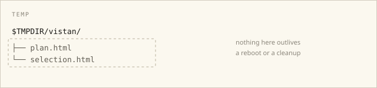
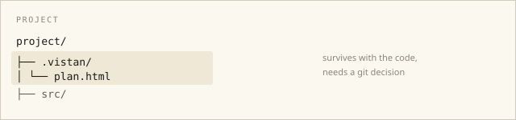
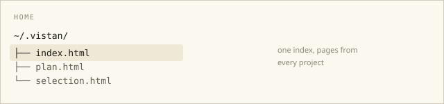

<!-- vistan: selection -->

# Where should generated pages live?

Today every run writes to `$TMPDIR/vistan` and opens a new tab. To revisit an old page, one of these has to become true.

## Keep them in `$TMPDIR`

Nothing changes: the page is written next to the server and opened.



```go
out := filepath.Join(os.TempDir(), "vistan", name+".html")
```

- Zero code to write.
- Gone when the OS cleans temp, and there is no way back to an earlier page.

## A `.vistan/` folder in the project

Pages sit next to the code and can be committed or ignored.



- Reopen and compare across branches.
- You have to decide git or `.gitignore`, and it clutters the tree.

## An index in `~/.vistan/`

Everything lives outside the project, with an index of past pages.



- Survives a temp cleanup and works from any project.
- One more folder to maintain, and deletion is manual.
